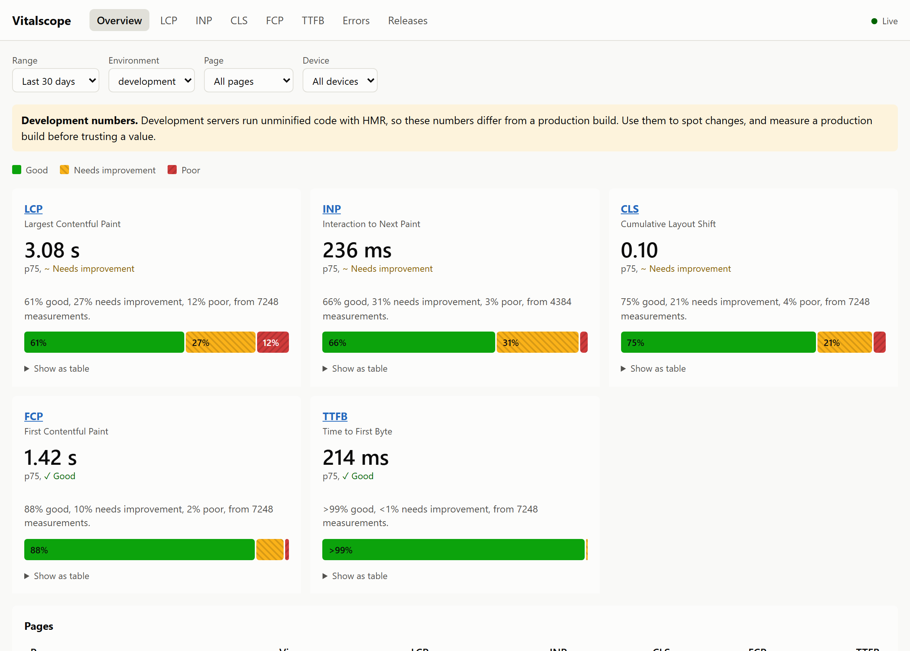
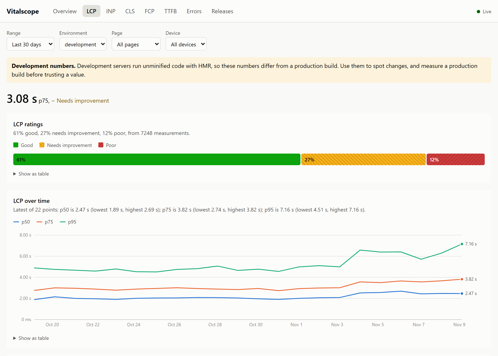
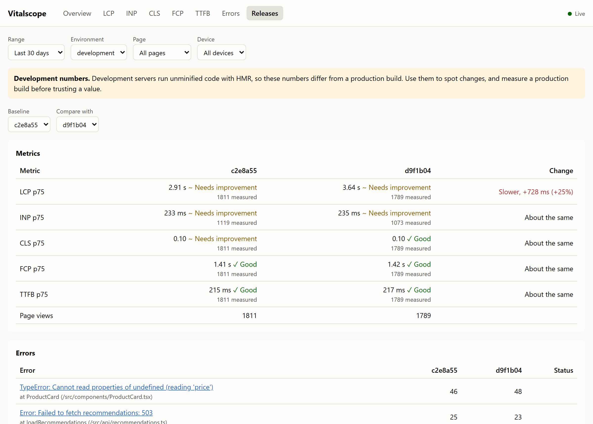
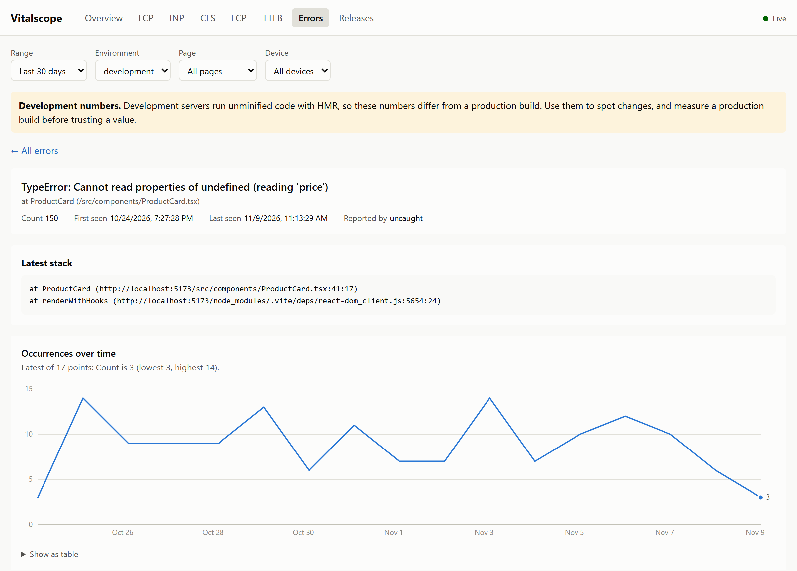

# Vitalscope

Core Web Vitals and JavaScript errors from your own browser, while you develop. Vitalscope measures LCP, INP, CLS, FCP and TTFB on your pages and stores them in a SQLite file in your project. You see them in a local panel or in your terminal. There is no server, account or Docker, and nothing leaves your machine.

<picture>
  <source media="(prefers-color-scheme: dark)" srcset="docs/images/overview-dark.png">
  
</picture>

Vitalscope is a local tool: it shows what your browser measures, not what real users experience.

## Quick start

Needs Node 24.15 or newer.

```bash
npm install --save-dev @vitalscope/cli @vitalscope/sdk
```

Load the SDK only in development:

```ts
if (import.meta.env.DEV) {
  void import("@vitalscope/sdk").then(({ init }) => init());
}
```

Start the collector next to your dev server, then open your app:

```bash
npx vitalscope dev
```

The panel is at `http://localhost:8787`. For React, Next.js and the script tag, see the [SDK README](packages/sdk/README.md).

## What you get

**Each metric over time,** with p50, p75 and p95, and its distribution. Filter by environment, page, device and time range.

<picture>
  <source media="(prefers-color-scheme: dark)" srcset="docs/images/metric-dark.png">
  
</picture>

**Two releases side by side.** Pass a `release`, such as a commit hash, and see which metric got slower and which errors are new. Below 5 measurements, or when the difference is too small, the panel gives no verdict.

<picture>
  <source media="(prefers-color-scheme: dark)" srcset="docs/images/releases-dark.png">
  
</picture>

**Errors grouped,** even when line numbers, build hashes or ids in the message change. The detail shows the last stack and when, where and in which release the error appeared.

<picture>
  <source media="(prefers-color-scheme: dark)" srcset="docs/images/errors-dark.png">
  
</picture>

**The same numbers in your terminal,** with `vitalscope report`:

```text
p75 by page, development  (~ needs improvement, ! poor)
Development servers run unminified code with HMR, so these numbers differ from a production build.

Page            Views       LCP       INP     CLS     FCP    TTFB
/                1958  3.09 s ~  241 ms ~    0.10  1.42 s  216 ms
/products/[id]   1113  3.36 s ~  228 ms ~  0.10 ~  1.48 s  214 ms
/search           851  2.96 s ~  221 ms ~  0.10 ~  1.41 s  212 ms

Errors

  182×  TypeError: Cannot read properties of undefined (reading 'price')
        at ProductCard (/src/components/ProductCard.tsx)
  128×  Error: Failed to fetch recommendations: 503
        at loadRecommendations (/src/api/recommendations.ts)
```

The screenshots and the report use generated sample data.

## Packages

| Package | |
| --- | --- |
| [`@vitalscope/sdk`](packages/sdk) | Measures in the browser. No runtime dependencies, about 5 kB gzip. Does nothing on pages that are not local |
| [`@vitalscope/cli`](packages/cli) | `vitalscope dev` (collector and panel) and `vitalscope report` |
| [`@vitalscope/protocol`](packages/protocol) | Event schemas, thresholds and limits shared by both |

## How accurate it is

- **Same values as Google's `web-vitals`.** Tests measure the same page with both libraries in Chromium, Firefox and WebKit: TTFB, FCP and LCP match exactly, CLS within 0.001 and INP within 8 ms.
- **No measurable cost.** In 20 page loads each, with and without the SDK, the median LCP and INP differ by less than one frame. `init` stays under 1 ms on a throttled mid-range mobile CPU.
- **Development numbers are labelled.** Dev servers run unminified code with HMR, so the panel and the report show development and production builds separately. The [SDK README](packages/sdk/README.md#measuring-a-production-build) explains how to measure a production build.

### Browser support

| Metric | Chromium | Firefox | WebKit (Safari) |
| --- | --- | --- | --- |
| LCP, INP, FCP, TTFB | Yes | Yes | Yes |
| CLS | Yes | No | No |
| Errors, pageviews | Yes | Yes | Yes |

Checked with the browser builds Playwright 1.64 ships (Chromium 156, Firefox 157, WebKit 27.2). Firefox and WebKit do not implement the Layout Instability API, so they report no CLS; the panel says so on the CLS page.

Browsers skip images with little detail, such as a logo or a single-color image, as LCP candidates. LCP then falls on the next largest element.

## Privacy and security

- The SDK starts only on `localhost`, `127.0.0.1`, `[::1]` and `*.localhost`. If it reaches a production bundle, it collects nothing from real users.
- Query strings and hashes are dropped, and e-mail addresses, tokens and long numbers are removed from paths and error messages before anything is sent.
- The collector listens only on `127.0.0.1` and accepts measurements only from local pages. Data stays in `.vitalscope/`, which ignores itself in git.
- Packages are published only from GitHub Actions, through npm trusted publishing. See [SECURITY.md](SECURITY.md) to report a vulnerability.

## Limitations

- Metrics belong to the full page load. In single-page apps, INP and CLS are reported for the route that is active when the page is hidden.
- The numbers come from your machine and your network. They help you spot regressions; they do not replace data from real users.

## Development

```bash
pnpm install
pnpm build
pnpm test
pnpm --filter @vitalscope/playground test:e2e   # Playwright, three browsers
```

[ROADMAP.md](ROADMAP.md) lists what is done and what is next (in Turkish).

## License

[MIT](LICENSE)
